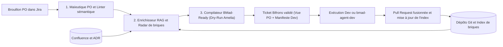

# jira-spec-compiler

Compilateur de tickets Jira assisté par IA qui transforme les intentions brutes des Product Owners en spécifications complètes, connectées à la documentation existante, enrichies des briques logicielles réutilisables du dépôt, et directement exécutables par les développeurs ou par un agent de code (`bmad-agent-dev`).

## Pourquoi ce projet existe

Dans la majorité des équipes produit et ingénierie, le ticket Jira souffre d'une double friction structurelle. Du côté Product Owner, rédiger un ticket exhaustif demande de fouiller dans des dizaines de pages Confluence, de deviner les cas limites et de connaître l'état actuel du code, ce qui finit souvent par un ticket d'une ligne rédigé à la hâte. Du côté développeur, ouvrir ce ticket déclenche une série d'allers-retours de clarification sur Slack, une recherche manuelle dans le dépôt Git et, trop souvent, la réécriture involontaire de composants pourtant déjà développés par une autre équipe.

`jira-spec-compiler` résout cette rupture en traitant le ticket Jira comme un code source métier que l'on compile avant le sprint. L'outil produit un "Ticket Bifrons" (à double visage): une synthèse métier courte et non polluée pour le Product Owner, couplée à un manifeste technique dense (extraits documentaires exacts, briques internes candidates avec score d'adhérence, fichiers Git ciblés et contrat de test) destiné au développeur humain et à l'agent BMad.

## Architecture fonctionnelle en trois piliers

### 1. Capture maïeutique et détection d'ambiguïtés pour le Product Owner

Au lieu d'imposer un formulaire lourd, `jira-spec-compiler` analyse le brouillon initial du Product Owner, détecte les termes flous ("rapide", "simple", "comme avant") et génère au maximum trois questions d'arbitrage fermées ou à choix rapide. Le Product Owner garde la maîtrise exclusive du contrat métier sans jamais avoir à rédiger de plomberie technique.

### 2. Ancrage documentaire et radar de briques réutilisables

Le moteur d'analyse croise l'intention du ticket avec deux sources vivantes: la base documentaire (Confluence, ADR, schémas OpenAPI, maquettes) et l'index sémantique du patrimoine logiciel interne (composants UI, services backend, connecteurs, utilitaires). Au lieu d'ajouter des liens génériques, le compilateur extrait le paragraphe pertinent et affiche un "Devis de réutilisation" qui compare l'effort d'un développement neuf à celui de l'assemblage d'une brique existante.

### 3. Qualification BMad-Ready et passerelle vers `bmad-agent-dev`

Avant le passage à l'état *Ready for Dev*, le ticket subit une lecture à blanc par le persona développeur de la méthode BMad ("Dry-Run Amelia"). L'agent vérifie qu'aucune règle de gestion, dépendance API ou condition de test ne manque pour coder la fonctionnalité sans deviner. Une fois le seuil de maturité atteint, le ticket expose un contexte d'exécution complet permettant au développeur de lancer directement `bmad-agent-dev` sur la story.

## Comparaison avant et après compilation

| Dimension du ticket | Ticket Jira classique | Ticket compilé par `jira-spec-compiler` |
| :--- | :--- | :--- |
| Saisie Product Owner | Rédaction manuelle longue ou ticket lacunaire d'une ligne | 3 puces d'intention métier + validation de 3 arbitrages ciblés |
| Documentation liée | Liens Confluence absents, obsolètes ou noyés dans des pages de 20 écrans | Extraits cités avec précision et alerte si la doc contredit la branche `main` |
| Réutilisation du code | Découverte tardive par le développeur (ou recodage en doublon) | Radar de briques dès le cadrage PO avec score d'adhérence et snippet d'import |
| Critères d'acceptation | Liste partielle centrée sur le cas nominal | Scénarios Gherkin nominaux, cas limites et payloads de test générés |
| Exécution par agent IA | Impossible sans longues séances de prompt engineering manuel | Score *BMad-Ready* et manifeste prêt à être exécuté par `bmad-agent-dev` |

## Structure du dépôt

Le dépôt s'organise autour des spécifications produit, des schémas de contrats et des modules d'orchestration:

1. [prd.md](prd.md) contient le Product Requirements Document complet du compilateur (vision, parcours utilisateurs, glossaire, exigences fonctionnelles et métriques).
2. [brainstorm.html](brainstorm.html) présente l'explorateur visuel interactif des 112 idées et questions issues des 6 techniques de brainstorming (Lotus Blossom, Starbursting, Crazy 8s, Job to Be Done, Backcasting, Emergent Thinking).
3. `schemas/` (à venir) regroupera le format standard du manifeste de brique (`brick.toml`) et le schéma de sortie du Ticket Bifrons.
4. `src/` (à venir) hébergera les connecteurs MCP Jira/Confluence, l'indexeur de briques Git et le simulateur de lecture BMad.

## Feuille de route d'implémentation

### Phase 1: socle de compilation et audit sur squad pilote
Mise en place du fichier `AGENTS.md` via `bmad-project-context`, indexation initiale des 50 briques réutilisables cœur du dépôt, et déploiement du compilateur en mode non bloquant (commentaire d'enrichissement automatique sur les tickets Jira au statut *To Refine*).

### Phase 2: radar de réutilisation et Dry-Run Amelia
Activation de l'assistant maïeutique pour les Product Owners, calcul du double chiffrage (neuf vs réutilisation de brique) et intégration du score de maturité *BMad-Ready* en séance de backlog refinement.

### Phase 3: exécution assistée par `bmad-agent-dev` et boucle d'apprentissage
Génération automatique du dossier de contexte de story à l'ouverture d'une tâche, exécution par les développeurs via `bmad-agent-dev` et mise à jour automatique du catalogue de briques à chaque Pull Request fusionnée.

## Licence

Distribué sous licence MIT. Consultez le document [prd.md](prd.md) pour le détail des spécifications fonctionnelles et architecturales.
